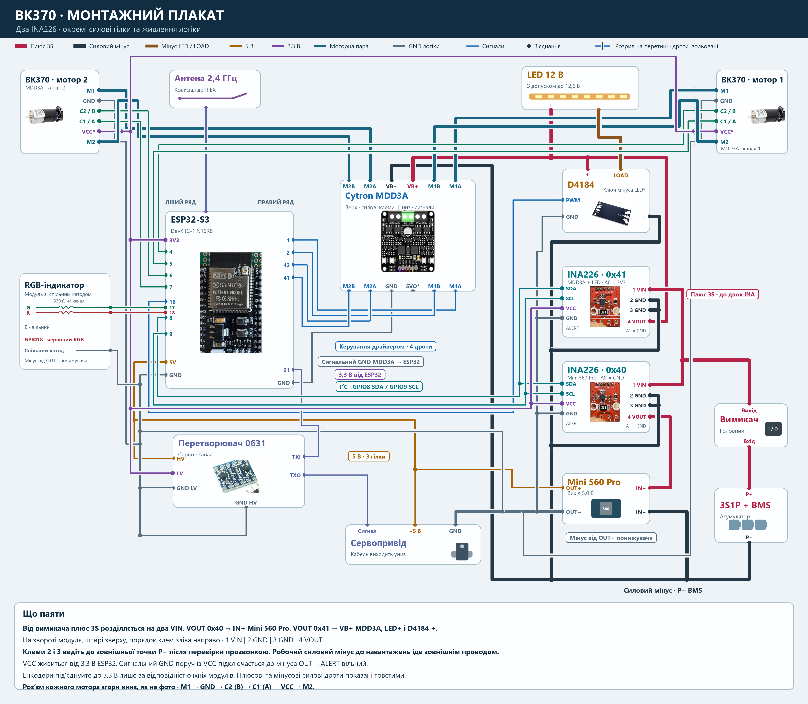
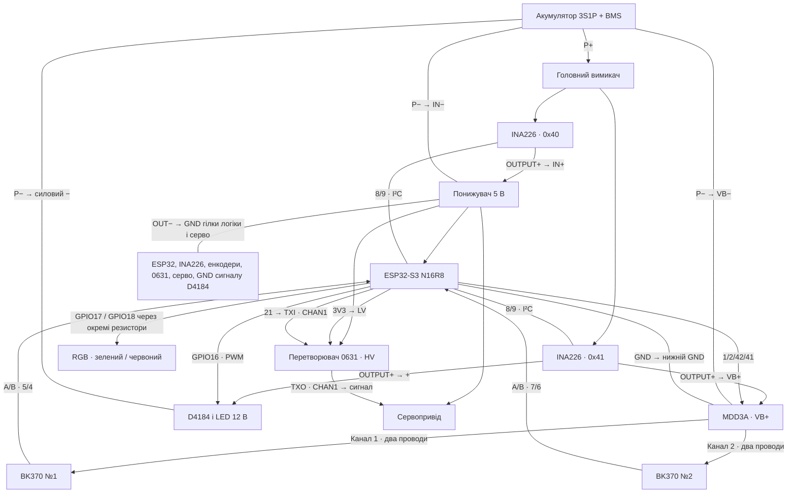

# Схема BK370 · однакова на кожній каретці

**Актуальний варіант з одним INA226 на всю систему.** Підключіть `P+` BMS через вимикач до `VIN` INA226. Від `VOUT` зробіть відгалуження до `VB+` MDD3A, `IN+` Mini 560 Pro та живлення LED/D4184. Повернення струму навантажень іде окремими силовими проводами до `P−` BMS. INA226 підключіть до ESP32 через 3,3 В, спільний GND, SDA GPIO8 та SCL GPIO9. У цій схемі датчик бачить споживання всієї каретки. Плакати нижче показують альтернативні варіанти без INA226 та з двома датчиками.

[Монтажний плакат із двома INA226 (PNG)](photos/bk370-photo-assembly.png) · [Монтажний плакат без INA226 (PNG)](photos/bk370-photo-assembly-no-ina.png) · [Покрокова схема паяння (PNG)](photos/bk370-wiring-step-by-step.png)

У варіанті без INA226 плюс батареї 3S після вимикача йде двома товстими проводами. Один іде на `IN+` Mini 560 Pro. Другий розгалужується на `VB+` MDD3A, плюс LED і клему `+` ключа D4184. Силовий мінус від `P−` BMS іде до `IN−` понижувача, `VB−` драйвера та силової клеми `−` D4184. Поточна прошивка BK370 вимагає даних INA226, щоб дозволити рух. Плакат без датчиків описує розпайку.

На монтажному плакаті чорні лінії показують силовий мінус від виходу BMS `P−`. Сіро-сині лінії показують мінус, який розводиться від `OUT−` понижувача. Нижній сигнальний `GND` драйвера MDD3A окремим проводом іде прямо до `GND` ESP32 поруч із проводами керування. Верхня силова клема `VB−` MDD3A підключається окремим товстим проводом до `P−` BMS. [Таблиця з’єднань Cytron](https://my.cytron.io/tutorial/getting-started-mdd3a-makerdrive-motor-driver-using-arduino#connection-table).

У неізольованого Mini 560 Pro `IN−` та `OUT−` мають спільний GND. Перед пайкою перевірте мультиметром зі знятим живленням, що ці клеми з’єднані на вашому модулі. `OUT−` є точкою розведення мінуса живлення 5 В. До неї йдуть окремі гілки від ESP32 та серво, щоб живлення серво не поверталося через плату ESP32. Фіолетові лінії показують дроти від `3V3` ESP32 до `VCC` обох INA, `LV` перетворювача 0631 та енкодерів, які підтримують 3,3 В.

На стороні 3S датчик `0x40` стоїть перед `IN+` Mini 560 Pro, а `0x41` — перед розгалуженням на `VB+` MDD3A та LED. Обидва датчики використовують GPIO8/9 та живлення логіки 3,3 В. Для телеметрії обох гілок прошивка має читати обидві адреси й використовувати фактичний опір кожного шунта. [Збільшений фрагмент підключення INA226](photos/bk370-two-ina226-wiring.png).

На фото звороту реального модуля, коли п’ять штирів зверху, нижні клеми зліва направо підписані `1 VIN`, `2 GND`, `3 GND`, `4 VOUT`. На покроковій схемі `VIN` названо `INPUT+`, а `VOUT` — `OUTPUT+`. На монтажному плакаті номери прив’язані до маркування на фото. Порядок винесених ліній на плакаті залежить від прокладання проводів.

Кожен провід на фотосхемі веде від підписаного контакту до іншого контакту або до позначеного відгалуження. Крапка на відгалуженні означає електричне з’єднання. Розрив лінії на перехресті означає, що проводи проходять повз один одного. **GND** — спільний мінус від виходу BMS `P−`.

Блок RGB зліва від ESP32 показує три фізичні дроти для індикатора зі спільним катодом. `GPIO17 → 330 Ω → G`, `GPIO18 → 330 Ω → R`, спільний катод → `GND` від `OUT−` понижувача. Контакт `B` вільний. Строб D4184 підключається до окремого виходу `GPIO16`.

Мінус LED підключається окремим проводом до `LOAD` модуля D4184, якщо цей вихід комутує мінус. Для короткого мідного джгута початковий орієнтир — AWG 16 (1,31 мм²) на магістраль від BMS і гілку живлення MDD3A, AWG 18 (0,82 мм²) на кожну моторну пару, AWG 20–22 (0,52–0,33 мм²) на коротку гілку 5 В за допустимого струму серво та AWG 24–26 (0,20–0,13 мм²) на сигнали. Для силового повернення використайте той самий переріз, що й для відповідного живлення. Звірте переріз зі струмом, довжиною, умовами прокладання та можливостями клем і шунта. [NI про переріз і падіння напруги](https://www.ni.com/en/shop/electronic-test-instrumentation/power-supplies-and-loads/what-are-programmable-power-supplies/cabling-and-current-resistance-loss-considerations-for-programma.html).

На схемі мотор 2 розташований зліва, мотор 1 справа відповідно до розташування силових клем на фото MDD3A. Ведіть моторні пари по краях, сигнали енкодерів окремо від силових проводів, коаксіал антени до верху подалі від моторних пар і PWM LED.

### Порядок контактів на роз’ємі мотора

На обох плакатах контакти показано згори вниз, як на фото роз’єму з боку проводів.

| Позиція на фото | Контакт | Мотор 1 (правий) | Мотор 2 (лівий) |
|---|---|---|---|
| 1 | `M1` | Силовий вихід `M1A` драйвера | Силовий вихід `M2A` драйвера |
| 2 | `GND` | Мінус живлення енкодера | Мінус живлення енкодера |
| 3 | `C2` / B | `GPIO4` ESP32 | `GPIO6` ESP32 |
| 4 | `C1` / A | `GPIO5` ESP32 | `GPIO7` ESP32 |
| 5 | `VCC` | Живлення енкодера, 3,3 В для сумісного модуля | Живлення енкодера, 3,3 В для сумісного модуля |
| 6 | `M2` | Силовий вихід `M1B` драйвера | Силовий вихід `M2B` драйвера |

| Звідки | Куди |
|---|---|
| ESP32 1 / 2 | MDD3A сигнальні M1A / M1B |
| ESP32 42 / 41 | MDD3A сигнальні M2A / M2B |
| MDD3A, вихід каналу 1 | Два силові проводи двигуна 1 |
| MDD3A, вихід каналу 2 | Два силові проводи двигуна 2 |
| Енкодер 1 C1/C2 (A/B) | ESP32 5/4 |
| Енкодер 2 C1/C2 (A/B) | ESP32 7/6 |
| Енкодери VCC/GND | Підтверджена напруга живлення енкодера / GND. Якщо A/B працюють на 5 В, потрібне узгодження до 3,3 В |
| ESP32 8 / 9 | SDA / SCL обох INA226, підтяжки до 3V3 |
| ESP32 3V3 | VCC обох INA226. ALERT вільний |
| ESP32 3V3 | `LV` перетворювача 0631 |
| ESP32 21 | `TXI` каналу `CHAN1` в ряду `LV` |
| `TXO` каналу `CHAN1` у ряду `HV` | Жовтий сигнальний провід серво |
| Понижувач OUT+ 5 В | ESP32 5V, `HV` перетворювача 0631, червоний провід серво |
| ESP32 16 | PWM D4184 після підтвердження, що вхід працює від 3,3 В |
| ESP32 17 | Опційний зелений LED через резистор |
| ESP32 18 | Опційний червоний LED через резистор |
| Вихід вимикача | `INPUT+` обох INA226 |
| INA226 `0x40` `OUTPUT+` | `IN+` Mini 560 Pro. Товстий червоний провід гілки 3S, як на `INPUT+` цього INA226 |
| INA226 `0x41` `OUTPUT+` | `VB+` MDD3A, плюс LED, клема `+` D4184 |
| `INPUT−` та `OUTPUT−` кожного INA226 | Два окремі короткі проводи до однієї зовнішньої точки шини `P−` біля датчика. Силовий мінус навантаження йде зовнішньою шиною |
| D4184 силова клема `−` | `P−` BMS |
| D4184 сигнальний `GND` | Розгалуження від `OUT−` Mini 560 Pro |
| LED − | LOAD D4184, якщо LOAD на цій платі комутує мінус |
| BMS `P−` | Силова клема `VB−` MDD3A, силова клема `−` D4184 та `IN−` Mini 560 Pro |
| Нижній сигнальний `GND` MDD3A | `GND` ESP32, окремий провід у джгуті керування |
| Mini 560 Pro `OUT−` | `GND` ESP32, коричневий провід серво, GND обох INA226 та енкодерів, `GND LV` / `GND HV` модуля 0631 та сигнальний `GND` D4184 |

**Чотири клеми модуля INA226.** `INPUT+` і `OUTPUT+` — два кінці шунта у плюсовому проводі. У документації мікросхеми та на збільшеному фрагменті вони названі `VIN+` і `VIN−` відповідно. `VBUS` має бачити плюс зі сторони `OUTPUT+`. `INPUT−` і `OUTPUT−` на плакаті означають клеми спільного мінуса модуля. Перед підключенням батареї перевірте фактичні доріжки та відповідність клем мультиметром. Кожен силовий мінус навантаження прокладіть зовнішнім проводом до `P−`. З R010 (0,01 Ом) межа вимірювання INA226 становить близько 8,2 А. Допустимий струм шунта й клем визначте окремо за конкретним модулем. [Документація INA226](https://www.ti.com/lit/ds/symlink/ina226.pdf)

Від `OUT+` понижувача починається гілка 5 В. Тонший провід підбирайте за фактичним піковим струмом і довжиною. Орієнтир 1,5 А для цієї гілки треба перевірити на виході, зокрема під час пуску серво. Датчик `0x40` стоїть перед понижувачем і вимірює вхідний струм 3S.

**Живлення від 3S.** Виміряйте напругу батареї та полярність виходу BMS. Звичайна 3S із комірками 4,2 В може мати до 12,6 В. LED має підтримувати фактичну напругу повністю зарядженої збірки. Перед підключенням ESP32, перетворювача рівнів і серво перевірте 5,0 В на виході понижувача. Контакт `5VO` MDD3A залиште вільним. [Cytron](https://my.cytron.io/tutorial/getting-started-mdd3a-makerdrive-motor-driver-using-arduino)

**Перетворювач рівнів 0631.** На фото продавця контакти `TXI` та `TXO` є в обох каналах. Для серво використовуйте обидва контакти одного каналу, як показано на збільшеному фрагменті. У відповідній схемі узгодження пара `TXI/TXO` підвищує рівень сигналу з 3,3 В до 5 В. Залиште `RXI`, `RXO` і канал `CHAN2` вільними. [Фото модуля на Prom](https://prom.ua/ua/p2764294331-kanalnyj-dvunapravlennyj-preobrazovatel.html) · [Опис принципу роботи SparkFun](https://learn.sparkfun.com/tutorials/retired---using-the-logic-level-converter/all)

**Антена.** Зовнішню антену 2,4 ГГц підключіть до штатного роз’єму IPEX/U.FL на версії ESP32-S3 із таким роз’ємом. [Espressif](https://documentation.espressif.com/esp-dev-kits/en/latest/esp32s3/esp32-s3-devkitc-1/user_guide_v1.1.html)

**Струм і сигнали.** У BK370 12 В вказано до 16 А при блокуванні, у MDD3A — 3 А тривало та 5 А піково на канал. До силового запуску перевірте пусковий струм і обмеження струму кожного каналу. INA226 бачить суму струмів. Звірте розпінування енкодерів за маркуванням або виміром конкретного екземпляра. [BK370](https://www.airsoftmotor.com/micro-dc-reduction-motor/circular-reduction-motor/gm25-bk370-hall-encoder-dc-gear-motor.html) · [MDD3A](https://www.cytron.io/cytron/p-3amp-4v-16v-dc-motor-driver-2-channels)

Сигнальні M1A/M1B та M2A/M2B — нижній ряд на повернутому фото. Силові клеми з такими самими назвами — верхній ряд. [Таблиця Cytron](https://www.cytron.io/tutorial/getting-started-mdd3a-makerdrive-motor-driver-using-arduino)

Контакти 10, 11 і 12 зарезервовані для INMP441.

Фото клем та роз’єму звірені з [Cytron](https://www.cytron.io/tutorial/getting-started-mdd3a-makerdrive-motor-driver-using-arduino) і [CHIHAI](https://www.airsoftmotor.com/Content/uploads/2023547745/20231117163921689046fb2c7d438c8dc1790eb535b5e6.jpeg). Фото INA226, D4184 та ESP32 походять із матеріалів користувача. Фото 0631 походить із картки MENstudio на Prom.
