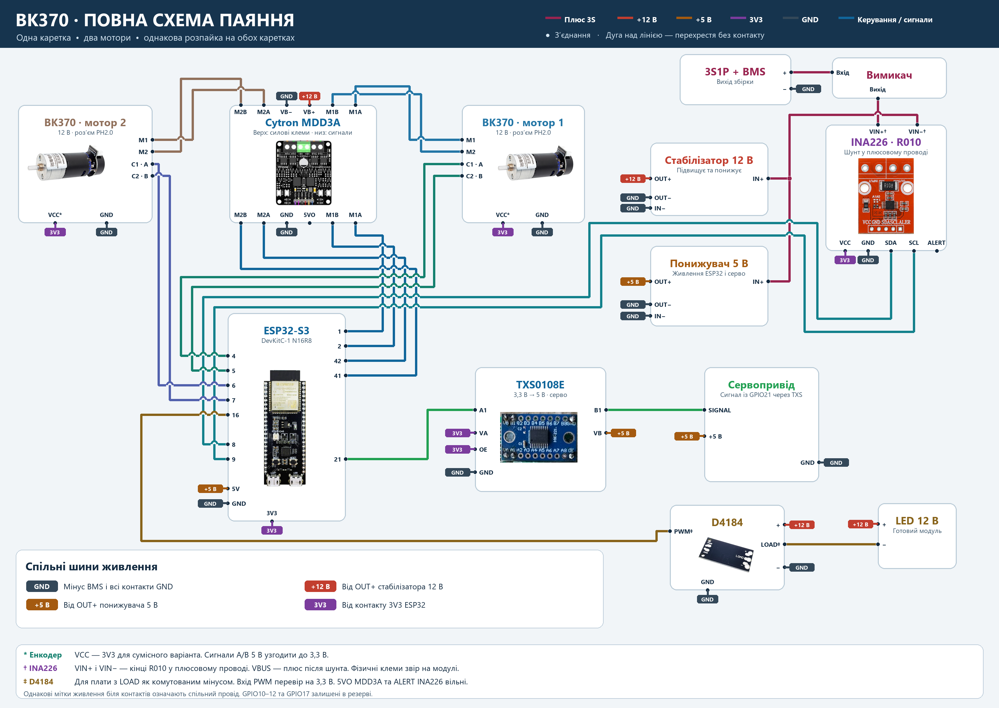
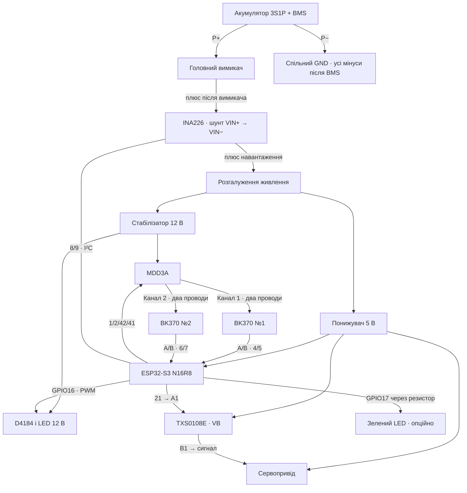

# Схема BK370 · однакова на кожній каретці

[Відкрити повну схему паяння (PNG)](photos/00-bk370-full-wiring.png)

Контакти з однаковою міткою **GND**, **3V3**, **+5 В** або **+12 В** з’єднуються зі своєю спільною шиною. Дуга над проводом позначає перехрестя без електричного контакту, крапка на розгалуженні — електричне з’єднання.

[1. MDD3A і роз’єм BK370](photos/01-mdd3a-bk370.png) · [2. Контакти ESP32](photos/02-esp32-pins.png) · [3. Живлення, INA226, TXS0108E і D4184](photos/03-power-and-accessories.png)

| Звідки | Куди |
|---|---|
| ESP32 1 / 2 | MDD3A сигнальні M1A / M1B |
| ESP32 42 / 41 | MDD3A сигнальні M2A / M2B |
| MDD3A, вихід каналу 1 | Два силові проводи двигуна 1 |
| MDD3A, вихід каналу 2 | Два силові проводи двигуна 2 |
| Енкодер 1 C1/C2 (A/B) | ESP32 4/5 |
| Енкодер 2 C1/C2 (A/B) | ESP32 6/7 |
| Енкодери VCC/GND | Підтверджена напруга живлення енкодера / GND. Якщо A/B працюють на 5 В, потрібне узгодження до 3,3 В |
| ESP32 8 / 9 | INA226 SDA / SCL, підтяжки до 3V3 |
| ESP32 3V3 / GND | INA226 VCC / GND. ALERT вільний |
| ESP32 3V3 | VA та OE TXS0108E |
| ESP32 21 | A1 TXS0108E |
| TXS0108E B1 | Жовтий провід серво |
| Понижувач OUT+ 5 В | ESP32 5V, VB TXS0108E, червоний провід серво |
| ESP32 16 | PWM D4184 після підтвердження, що вхід працює від 3,3 В |
| ESP32 17 | Опційний зелений LED через резистор |
| Вихід 12 В + / GND | D4184 + / − відповідно. GND сигналу D4184 до GND ESP32 |
| LED + / LED − | +12 В / LOAD відповідно, якщо LOAD на цій платі комутує мінус |
| BMS P− | IN− обох перетворювачів, OUT− неізольованих перетворювачів, силовий і сигнальний GND MDD3A, GND ESP32, INA226, TXS0108E, енкодерів, коричневий провід серво і катод опційного зеленого LED |
| 12 В OUT+ | Плюс силового входу MDD3A |

**INA226.** VIN+ і VIN− — кінці шунта, який стоїть у розриві плюсового проводу. VIN− у цій схемі йде до плюса навантаження. VBUS має бачити цей плюс. У модуля з INPUT/OUTPUT перевірте фактичні доріжки й контакти мультиметром. R010 означає 0,01 Ом. Допустимий струм шунта й клем визначте за конкретним модулем. [Документація INA226](https://www.ti.com/lit/ds/symlink/ina226.pdf)

**3S → 12 В.** Для стабільних 12 В потрібен перетворювач, який працює за напруги батареї і вище, і нижче 12 В та витримує навантаження двох моторів. Вихід 5 В MDD3A залиште вільним при окремому понижувачі. Перед підключенням плат виставте 5 В і 12 В мультиметром.

**Струм і сигнали.** У BK370 12 В вказано до 16 А при блокуванні, у MDD3A — 3 А тривало та 5 А піково на канал. До силового запуску перевірте пусковий струм і обмеження струму кожного каналу. INA226 бачить суму струмів. Звірте розпінування енкодерів за маркуванням або виміром конкретного екземпляра. [BK370](https://www.airsoftmotor.com/micro-dc-reduction-motor/circular-reduction-motor/gm25-bk370-hall-encoder-dc-gear-motor.html) · [MDD3A](https://www.cytron.io/cytron/p-3amp-4v-16v-dc-motor-driver-2-channels)

Сигнальні M1A/M1B та M2A/M2B — нижній ряд на повернутому фото. Силові клеми з такими самими назвами — верхній ряд. [Таблиця Cytron](https://www.cytron.io/tutorial/getting-started-mdd3a-makerdrive-motor-driver-using-arduino)

Контакти 10, 11 і 12 зарезервовані для INMP441.

Фото клем та роз’єму звірені з [Cytron](https://www.cytron.io/tutorial/getting-started-mdd3a-makerdrive-motor-driver-using-arduino) і [CHIHAI](https://www.airsoftmotor.com/Content/uploads/2023547745/20231117163921689046fb2c7d438c8dc1790eb535b5e6.jpeg). Фото INA226, TXS0108E, D4184 та ESP32 походять із матеріалів користувача.
